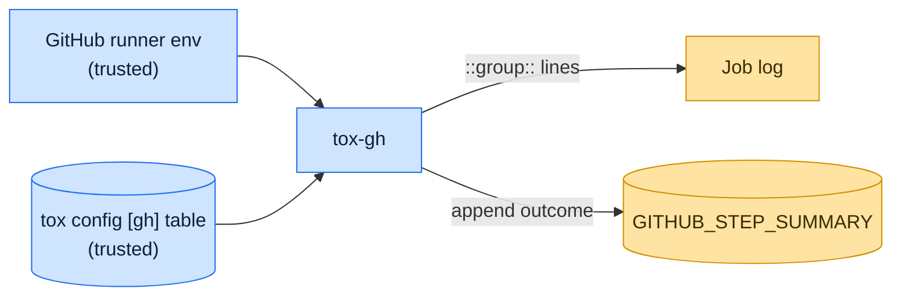

# Threat model

This model says what tox-gh trusts, where untrusted input enters, and which guarantees hold at each boundary, so a
report can be classified as a vulnerability or a bug. [SECURITY.md](SECURITY.md) covers reporting; if the two disagree,
SECURITY.md wins and we fix this file.

## How tox-gh works

When `GITHUB_ACTIONS` is `true` and no environment is given explicitly, tox-gh maps the running Python's version,
through the `[gh]` table of the tox configuration, to the environments to run. It wraps each environment's install and
run output in `::group::` lines and appends a pass or fail line per environment to the step summary file.

## Compared with similar tools

We drew the boundary where comparable projects in other ecosystems draw theirs. The shared rule, stated by the
[Node.js threat model](https://github.com/nodejs/node/blob/main/SECURITY.md#the-nodejs-threat-model), is that a report
which first needs a trusted element compromised is out of scope; the first triage question, as
[DOMPurify](https://github.com/cure53/DOMPurify/blob/main/SECURITY.md#what-we-consider-a-vulnerability) puts it, is what
the attacker controls.

| Project                                                                                                          | Language   | Where it draws the line                                                                                                                                |
| ---------------------------------------------------------------------------------------------------------------- | ---------- | ------------------------------------------------------------------------------------------------------------------------------------------------------ |
| [GitHub workflow commands](https://docs.github.com/en/actions/reference/workflows-and-actions/workflow-commands) | Actions    | Any process in a job can print workflow commands; GitHub documents stopping them for untrusted output.                                                 |
| [Vitest](https://github.com/vitest-dev/vitest/security/policy)                                                   | JavaScript | Trusts the developer, their machine, the config file, plugins and every project file; a report counts only if it needs no trusted element compromised. |
| [Lefthook](https://github.com/evilmartians/lefthook/security/policy)                                             | Go         | Runs the commands its configuration names by design; that is not a vulnerability.                                                                      |

## Trusted

An attacker who controls any of these already has what tox-gh could give them:

- Everything tox trusts, including the `[gh]` mapping in the project configuration.
- The runner's environment variables and the step summary file they name.

## Untrusted inputs

| Input                       | Comes from                                    | What tox-gh guarantees                                                      |
| --------------------------- | --------------------------------------------- | --------------------------------------------------------------------------- |
| Output of commands tox runs | Tests and tools, possibly from a pull request | Passed through unchanged; tox-gh adds only its own group and summary lines. |

## Threats and controls

| STRIDE    | Threat                                                                     | Control                                                             |
| --------- | -------------------------------------------------------------------------- | ------------------------------------------------------------------- |
| Tampering | A crafted environment name injects a workflow command through `::group::`. | Environment names come from the trusted configuration.              |
| Tampering | The summary write lands outside the summary file.                          | Opens exactly the path `GITHUB_STEP_SUMMARY` names, in append mode. |

## Release chain

Releases run on the shared [tox-dev/github-workflows](https://github.com/tox-dev/github-workflows) pipeline. A release
App, not a person, pushes the release commit and tag; the build installs its tools from a hash-checked `pylock.toml`
resolved with a seven-day upload cooldown by default; PyPI receives the files through
[trusted publishing](https://docs.pypi.org/trusted-publishers/) with attestations, and the GitHub Release is immutable.
Every workflow pins third-party actions to a commit SHA.

## Vulnerability or bug

| Report                                               | Verdict             | Why                                                            |
| ---------------------------------------------------- | ------------------- | -------------------------------------------------------------- |
| A test prints `::add-mask::` or `::error::`          | Not a vulnerability | Job output is the runner's concern; tox-gh does not filter it. |
| tox-gh writes a summary line into another file       | Vulnerability       | Write target is a guarantee.                                   |
| The matrix runs the wrong environments for a version | Bug                 | Selection correctness.                                         |

## Severity

- **High:** tox-gh writes anywhere other than the step summary file.
- **Medium:** tox-gh emits a workflow command built from anything other than tox environment names and outcomes.
- **Low:** a crash or confusing error on a malformed `[gh]` mapping.

## Accepted risks

- tox-gh does not filter workflow commands printed by the commands it runs.

## Keeping this current

Revisit this model when tox-gh gains a new input source, network access, a new way to run code, or a new place it writes
to, and whenever an advisory is published.
